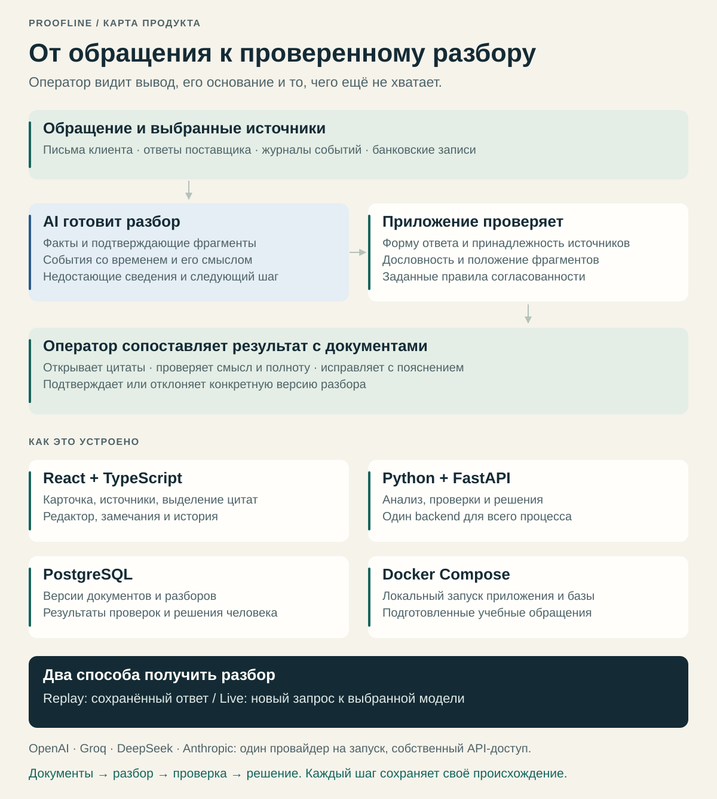
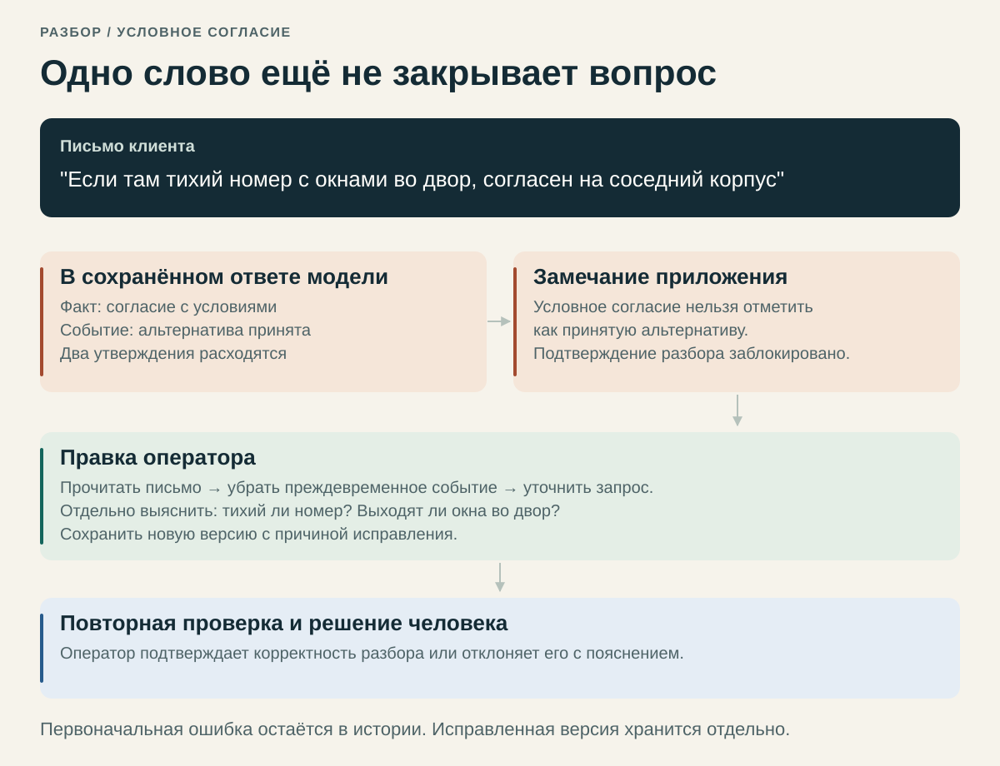
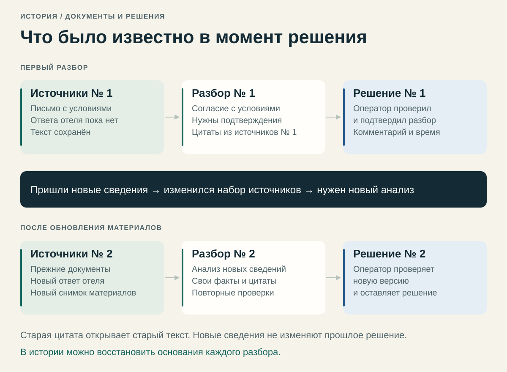

# Proofline: на чём основан ответ

Обращение, документы и переписка складываются в разбор, который можно проверить.

Отель предложил гостю соседний корпус. В ответ пришло письмо: "Если там тихий номер с окнами во двор, согласен на соседний корпус". В переписке есть слово "согласен", в справочнике отеля действительно указаны номера с окнами во двор. Можно ли считать замену принятой?

Сотруднику поддержки предстоит выяснить, какой номер предложили именно этому гостю и подтвердил ли отель оба условия. Для этого приходится сопоставлять письмо, записи переписки и сведения о размещении. Одного уверенного пересказа здесь мало: человек должен увидеть, откуда взялся каждый вывод.

**Proofline – авторский проект рабочего места для разбора обращений с помощью AI.** Он собирает факты, показывает их основания, выстраивает события по времени и помогает сформулировать, чего ещё не хватает. Оператор читает результат рядом с источниками, исправляет его и фиксирует своё решение.

> **Об этом проекте** Proofline создан для портфолио, статей и разбора продуктовых и инженерных решений. Здесь описан конечный вид проекта; текущее состояние реализации и проверок указано в [README](../../README.md). Сценарии и документы учебные, без реальных клиентских данных. Сохранённые разборы можно изучать без подключения к модели; для нового анализа действует BYOK – собственный аккаунт, API-ключ и выбранная модель. Владелец запуска отвечает за доступ, расходы и передаваемые данные. Proofline работает с текстовыми источниками в локальном демо с одним оператором. Он готовит разбор для человека; юридическая оценка, отправка сообщений, возвраты и другие финансовые действия остаются за его пределами. Качество на реальных обращениях и экономический эффект требуют отдельной проверки. Связь с Travel тематическая: это два самостоятельных приложения.

## Вся история перед глазами

Когда оператор открывает обращение, ему нужны ответы на несколько простых вопросов. Что произошло? Какие сведения это подтверждают? Где расходятся версии? Что спросить, чтобы продолжить разговор?

В Proofline обращение и доступные документы собраны в одной карточке. Оператор выбирает, какие источники включить в анализ: например, письмо клиента, журнал получения сообщений и ответ поставщика. Рядом видны и документы, о существовании которых известно, но текст которых ещё не получен. Так можно отличить пробел в материалах от уже проверенного факта.

AI получает выбранные тексты и готовит разбор. В нём есть факты с подтверждающими фрагментами, хронология и предложение следующего шага. Приложение проверяет форму ответа, ссылки на источники и заданные правила согласованности. После этого оператор разбирает результат, пользуясь замечаниями и исходными документами.

*Схему можно [открыть отдельно](assets/proofline-map.svg). Названия технологий стоят рядом с их ролью в работе продукта.*

Карточка помогает удерживать весь вопрос целиком. Если согласие подтверждено, рядом видно письмо. Если подтверждения нет, это становится отдельным пунктом для продолжения работы. Если разбор противоречит сам себе, замечание ведёт к конкретному месту, которое нужно проверить.

## За каждым выводом можно открыть документ

Вернёмся к замене корпуса. В письме клиента есть два условия: тишина и окна во двор. Общая карточка здания говорит, что такие номера существуют, но ничего не сообщает о номере, выделенном этому гостю. Эти тексты относятся к одному вопросу и при этом подтверждают разные вещи.

В Proofline у установленного факта есть ссылка на конкретные фрагменты источника. Нажатие открывает документ и выделяет нужные строки. На широком экране вывод и письмо видны рядом; на телефоне можно переключаться между ними, сохраняя выбранный фрагмент. Оператору легко прочитать соседние предложения и заметить условие, которое потерялось в пересказе.

Иногда доказательство находится в нескольких местах одного документа. Тогда приложение показывает отдельные выделения. Текст между ними остаётся видимым: там может стоять отрицание, уточнение или оговорка, меняющая смысл. Удобство проверки здесь важнее короткой красивой цитаты.

Приложение также проверяет, что указанный фрагмент действительно присутствует в той версии документа, которую получила модель. Если ссылка ведёт в чужой источник или цитата не находится, подтвердить такой разбор нельзя. Смысловую связь между цитатой и выводом оценивает оператор: даже точная строка может оказаться недостаточным основанием.

В истории с отелем согласие дано с условиями, а выполнение условий ещё предстоит подтвердить. Именно эту разницу должен сохранить разбор.

## Время тоже требует пояснения

Теперь другой вопрос: когда поставщик получил согласие клиента? В материалах есть время отправки письма и отметка о его получении. Оба значения могут быть правильными, но отвечают они на разные вопросы.

Proofline сохраняет эти различия в хронологии. Сообщение отправлено в один момент, получено в другой. В каждом событии видны его смысл, время с часовым поясом и подтверждающий фрагмент. Можно открыть источник и проверить, почему события расположились именно так.

Например, в одном учебном обращении клиент отправил согласие в 09:34, а поставщик получил его в 09:36. Эти две минуты помогают увидеть устройство разбора: письмо и запись о доставке дают разные части истории. Если для ответа важно получение сообщения, отметка об отправке сама по себе вопрос не закрывает.

Так же устроена работа с деньгами. Снятие блокировки суммы на карте, начало возврата и зачисленный возврат обозначают разные события. В карточке сохраняется конкретный исход, найденный в материалах. Оператор может проверить банковскую запись и объяснить, что именно известно о движении денег.

## Когда материала не хватает

Представим, что журнал подтверждает получение письма, а самого письма в подборке нет. Из журнала известно, что клиент ответил. Содержание ответа остаётся неизвестным: он мог согласиться, отказаться или задать вопрос.

Подтвердить согласие клиента по одному журналу нельзя: в карточке оно остаётся со значением "Не подтверждено", а следующий шаг – запросить оригинал ответа. Это уже полезный результат работы: сотрудник понимает, какой документ нужен и зачем. Отсутствие подтверждения не превращается в утверждение, что согласия никогда не было.

У истории с корпусом своя недостающая часть. Нужно выяснить, выполнены ли оба условия гостя: тихий номер и окна во двор. В списке они остаются отдельными пунктами. Ответ только про окна не закрывает вопрос о тишине.

Оператор может прочитать предложенные вопросы, исправить их и скопировать для дальнейшей работы. Вместо общего "уточните обстоятельства" у него появляется предметный запрос. При следующем разборе будет понятно, получили ли нужное подтверждение или переписка снова ушла в сторону.

## Что происходит, когда AI ошибается

В одном из сохранённых ответов модель одновременно отметила условное согласие клиента и добавила в хронологию событие "Альтернатива принята". На вид это аккуратно заполненная карточка. По смыслу два утверждения расходятся: условие ещё требует ответа, а событие уже объявляет выбор состоявшимся.

Proofline показывает противоречие и блокирует подтверждение разбора. Оператор открывает письмо, проверяет условия и исправляет карточку: сохраняет условное согласие, убирает преждевременное событие и уточняет недостающие подтверждения. Правка проходит проверки заново.

Исправление создаёт новую версию. Исходный ответ модели остаётся доступен вместе с замечаниями, а у правки видны её происхождение и причина. Можно восстановить весь путь от неудачного вывода до того разбора, с которым человек согласился.

**Кнопка "Подтвердить разбор" фиксирует результат проверки оператором.** Он может подтвердить и карточку с недостающими данными, если она верно описывает ситуацию и нужные уточнения. Даже если приложение не нашло ошибок, оператор может отклонить разбор и указать причину: полноту истории и достаточность доказательств оценивает он.

## Новое письмо не переписывает прошлое

Разбор привязан к тем материалам, на которых он был сделан. Позже может прийти ответ отеля, уточниться запись поставщика или появиться новая версия документа. Тогда меняется основание для решения.

Proofline сохраняет прежние источники вместе с разбором. Если открыть старую цитату, она приведёт к тексту, который видел оператор в тот момент. Новое письмо добавляет сведения к текущему обращению, а прежнее решение остаётся в истории. Для изменённого набора материалов нужен новый анализ и новая проверка.

Такая связь полезна при возвращении к сложному вопросу. Можно выяснить, почему оператор запросил подтверждение, даже если сегодня оно уже лежит в карточке. Видно и то, какую ошибку внесла модель, и то, как человек её исправил.

Приложение учитывает и обычную работу в нескольких вкладках. Если в одной обращение уже изменилось, другая не сможет сохранить решение поверх устаревших данных. Оператор увидит конфликт, сохранит перед глазами свой черновик и сверит его с новой версией. Запоздавший ответ модели тоже сохраняется отдельно, если за время анализа человек успел изменить обращение.

## Зачем это оператору и команде

Основная работа при сложном обращении часто происходит между документами: найти нужное письмо, сопоставить время, понять значение статуса, заметить условие. Proofline собирает результат этой работы в форму, которую можно последовательно проверить.

**Оператору проще обосновать ответ.** Факт ведёт к источнику, а спорное место можно показать прямо в тексте. Разговор о том, почему сделан вывод, начинается с конкретного письма или события.

**Недостающие сведения превращаются в задачу.** В карточке видно, нужно ли получить оригинал сообщения, подтверждение условий размещения или банковский документ. Это помогает продолжить разбор с определённого вопроса.

**История помогает разбирать ошибки.** Ответ модели, правка и решение человека сохранены по отдельности. На таком материале можно обсуждать качество работы: что упустила модель, чего не было в источниках, какую проверку стоит улучшить.

**У AI есть понятное место в процессе.** Он читает выбранные тексты и предлагает разбор. Код проверяет заданные ограничения, оператор сопоставляет результат с обстоятельствами обращения. Из этого разделения видно, какие ошибки можно ловить автоматически, а какие требуют человеческого внимания.

Для инженерного знакомства проект устроен компактно. React показывает рабочее место оператора. Python и FastAPI обслуживают анализ, проверки и решения. PostgreSQL хранит документы и историю; Docker Compose запускает приложение и базу вместе. Весь путь от входного письма до подтверждённой карточки можно проследить в одном проекте.

## Как Proofline связан с Travel

[Travel](https://github.com/svasorcery/travel-agency/blob/dev/docs/product/travel.ru.md) показывает сервис путешествий целиком: выбор дороги и жилья, заказы, личный план и поддержку. Там человек сначала организует поездку, а затем возвращается к своему заказу, если обстоятельства изменились.

Proofline подробно рассматривает один момент из этой жизни: сотруднику нужно разобраться в обращении, опираясь на переписку и документы. На таком масштабе становятся заметны вопросы, которые легко потерять за общим статусом заказа. Действительно ли клиент согласился? Что именно пришло раньше? Какая запись подтверждает возврат? Какого документа пока нет?

Два проекта удобно смотреть последовательно. В [рассказе о Travel](https://github.com/svasorcery/travel-agency/blob/dev/docs/product/travel.ru.md) можно увидеть путь путешественника и работу сервиса вокруг него. Затем в Proofline – задержаться на одном спорном обращении и пройти его вместе с оператором, от первой цитаты до сохранённого решения.

Для знакомства достаточно трёх историй: открыть согласие с буквальным подтверждением, убрать оригинал письма и увидеть, какого основания теперь не хватает, затем разобрать ошибку с условным согласием. В последней особенно хорошо виден смысл проекта: человек замечает расхождение, понимает его причину и оставляет после себя проверяемую историю.

---

**Посмотреть дальше:** [код и запуск Proofline](../../README.md) · [демонстрационные истории](../operator-ui.md) · [устройство и требования](../spec.md) · [исследование и измерения](../research.md) · [Travel](https://github.com/svasorcery/travel-agency/blob/dev/docs/product/travel.ru.md) · [статьи автора](https://blog.vsinyavsky.ru/).
